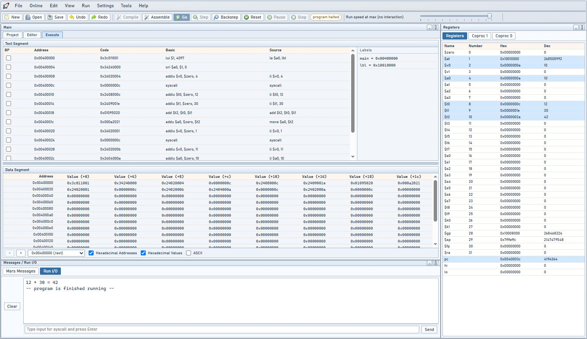
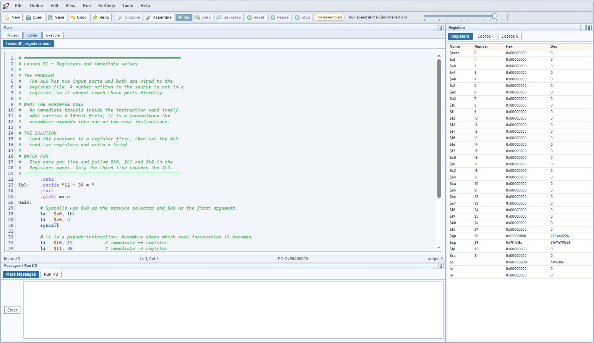
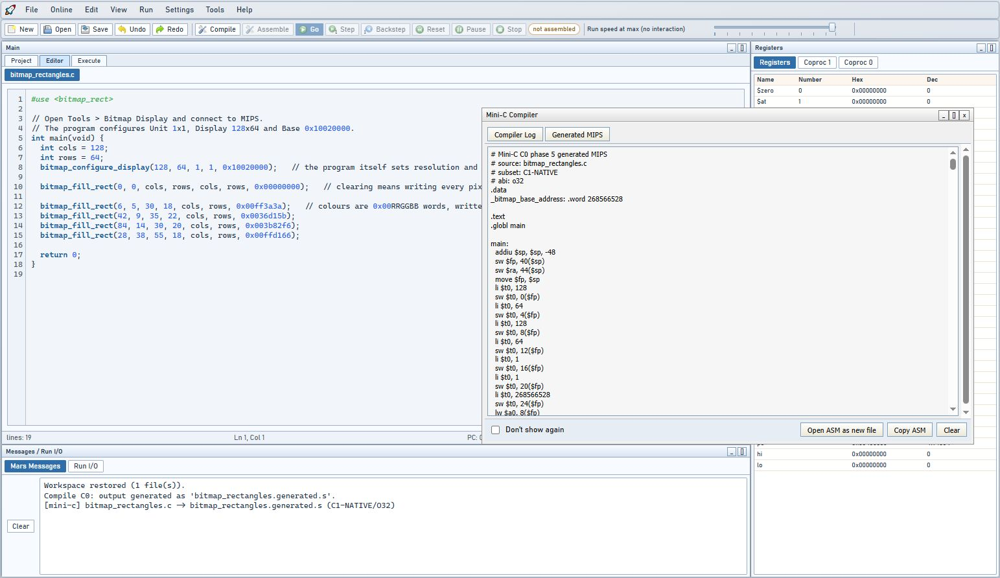
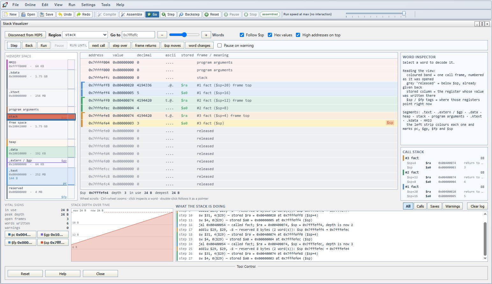
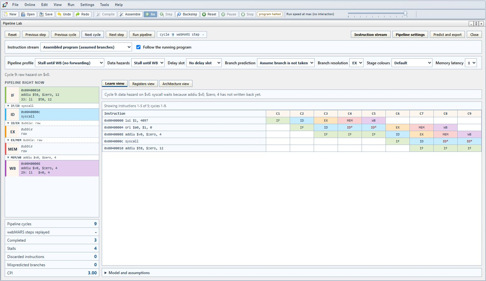
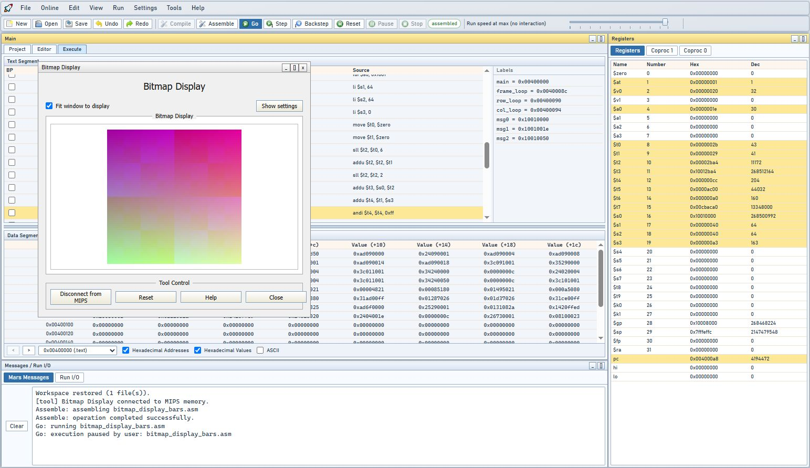
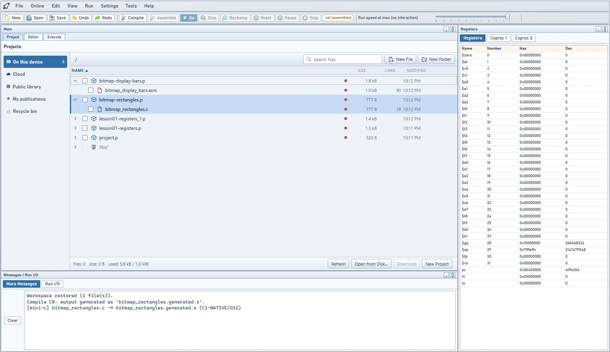

# webMARS v0.7.4

**Write MIPS. Watch it run. Understand the machine.**

webMARS is a free, open-source MIPS32 programming environment for your browser,
inspired by MARS 4.5. Write Assembly, compile Mini-C, step through your program
and explore registers, memory and interactive devices in one workspace.
Open it and start learning — no Java installation or account needed.

**[Launch webMARS](https://webmars.nfiles.top/)** ·
[Getting started](#your-first-program) ·
[Explore the tools](#a-lab-full-of-tools) ·
[Manual (Português)](https://webmars.nfiles.top/manual/)



*Inspect the instructions, follow the registers and read program output without
leaving the workspace.*

## Your first program

1. [Open the first lesson: registers and immediate values](https://webmars.nfiles.top/e/lesson01-registers), then choose **Open as New Project**.
2. Read the example in **Editor**, then click **Assemble**.
3. Click **Go** to run it, or **Step** to follow one instruction at a time.
4. Look for `12 + 30 = 42` in **Run I/O** and inspect `$t0`, `$t1` and `$t2` in **Registers**.
5. Try **Backstep**, change a value in the source and assemble again.

Use **File → Examples** to pick your next program. The included lessons take
you from registers and loops to arrays, function calls, recursion and devices.
Help and reference material are available from the **Help** menu as you work.

## A workspace for learning

The editor has syntax highlighting, tabs and multi-file projects. When you
assemble a program, the **Execute** view brings together machine code, source
instructions, labels and memory. Breakpoints, speed controls and backward
stepping help you investigate what each instruction changes.



The interface adapts to desktops, tablets and phones, with light, dark and
system themes. Interface text, help and examples are available in **20 languages**,
including English, Portuguese and Spanish, with right-to-left layouts for
Arabic, Urdu and Persian.

## From Mini-C to MIPS

Start with a small C-like program, click **Compile**, and inspect the Assembly
it generates. Open that output as a source file to assemble, execute and debug
it with the same tools you use for handwritten MIPS.



Mini-C provides teaching profiles for exploring functions, arrays, pointers and
other systems-programming concepts. Try the
[rectangles example](https://webmars.nfiles.top/e/bitmap-rectangles) to connect
high-level code with memory-mapped graphics.

## A lab full of tools

Open **Tools** to connect visual experiments to your programs. The 20 included
tools cover the stack, pipeline, caches, branch prediction, graphics, terminals,
input devices and more.

### See how function calls use the stack

**Stack Visualizer** shows call frames, saved registers and changes to `$sp`.
Step into a recursive function and follow the stack as it grows and unwinds.



*Try [recursive factorial](https://webmars.nfiles.top/e/factorial-recursive),
connect Stack Visualizer to MIPS and enter a small number such as `5`.*

### Follow instructions through a pipeline

**Pipeline Lab** lets you explore the five stages, data hazards, stalls,
forwarding and branch prediction. Change a profile and compare how the
instruction timeline changes.



*For a guided activity, use the [seven pipeline labs](docs/labs/README.md),
with worksheets and separate solutions for teachers.*

### Turn memory writes into graphics

**Bitmap Display** turns a framebuffer into a visible image. Experiment with
colours and drawing routines while watching the Assembly that drives them.



*Try [animated colour bars](https://webmars.nfiles.top/e/bitmap-display-bars).
Open Bitmap Display and connect it to MIPS before running the program.*

### Keep exploring

| Explore | Tools to open |
| --- | --- |
| Memory access and locality | Data Cache Simulator · Memory Reference Visualization |
| Branch prediction | BHT Simulator |
| Instruction behaviour | MIPS X-Ray · Instruction Counter · Instruction Statistics · Register Watch |
| Bits and floating point | Floating Point Representation |
| Input, output and interrupts | Keyboard and Display MMIO · Digital Lab Sim · System Clock and Timer |
| Graphics and text | Bitmap Terminal Tool · TTY Device + ANSI Terminal |
| Interactive experiments | Mars Bot · ScavengerHunt |
| Getting comfortable | Introduction to Tools · Screen Magnifier |

For a larger project, explore **MARS-OS** in the bundled examples: a desktop,
terminal, text editor, spreadsheet and BASIC interpreter written in MIPS
Assembly and displayed through the ANSI terminal tool.

## Keep your projects together

Use the **Project** view to organise files and folders, reopen local work,
import files from disk and download a copy. Browser storage restores your
workspace between visits; download important work for a lasting backup.



Optional **Cloud** accounts let you synchronise projects across devices.
The **Public library** helps you find shared projects, and publishing lets you
share your own work through a link. Local editing and simulation work without
an account.

## Bring webMARS to your classroom

Share a lesson link, demonstrate a program step by step, or give students a
project to investigate. Permanent example links and pinned publication
revisions help everyone start with the same material.

- [Teacher Kit](manual/teacher-kit/README.md) — first-class activities, sharing, migration and hosting guidance in Portuguese.
- [Pipeline labs](docs/labs/README.md) — seven guided experiments with teacher solutions.
- [User manual](manual/README.md) — illustrated Portuguese guide, practical exercises and searchable reference.

## Run it on your own computer

With **Node.js 20 or newer**, run these commands from the repository folder:

```bash
npm ci
npm start
```

Open [http://127.0.0.1:8080](http://127.0.0.1:8080) in your browser.
To use another port, run `npm start -- --port 9000`.

Schools and other hosts can also serve webMARS as a static website.
See the [self-hosting guide](docs/self-hosting.md) for deployment and optional
Cloud configuration. The official installation's automatic usage statistics
are explained in [Usage metrics and privacy](docs/usage-metrics.md).

## Highlights in v0.7.4

- `v0.7.4`: safer project import and recovery, MIPS compatibility fixes, accessible menus and updated manual.

- `v0.7.3`: updated build numbering and validation fixes.

- `v0.7.2`: MIDI editing and the four Piano MIPS movements, improved context menus and refreshed examples.

- `v0.7.1`: responsive usage statistics and About window, build-aware telemetry, account-based internal traffic, and voluntary feedback with optional screenshots and project source.

- `v0.7.0`: a cleaner menu bar, with the decorative icon beside File removed.

- `v0.6.6`: compare local and Cloud versions side by side, recover deleted projects from the recycle bin, and enjoy improved public-project browsing and startup recovery.

See the [changelog](help/en/changelog.html) for the full release history.

## Contribute and learn more

Bug reports, teaching examples, translations and code contributions are welcome.
Start with [your first contribution](docs/contributing-first-change.md).
The [architecture guide](docs/code-architecture.md) maps the code, and the
[Tool API](docs/tool-api.md) explains how to add a tool.

<details>
<summary>Developer checks and technical reference</summary>

The application is distributed as static source. Check it with `npm run build`,
run the regression suite with `npm test`, or use `npm run validate` for the
complete validation workflow. `npm run package:release` creates the release
folder, ZIP and checksum under `dist/`.

The [evidence index](docs/evidence.md) links compatibility, test, performance
and accessibility reports. Their regeneration commands are:

```bash
npm run docs:matrix
npm run fetch:mars
npm run differential
npm run coverage
npm run mutation
npm run benchmark
npm run audit:a11y
```

The functional runtime is not cycle-accurate; Pipeline Lab is a separate
educational timing model. For detailed scope, see
MARS compatibility (`mars-conformance.md`),
[Pipeline Lab](docs/pipeline-lab.md) and
[browser support](docs/portability.md).

See the [release process](docs/release-process.md) for build stamping and
packaging, and the [screenshot notes](docs/images/readme/README.md) for the
examples and settings used in this README.

</details>

## Credits and licence

webMARS is an independent browser implementation maintained by **Nélson Ferreira**,
inspired by the original **MARS MIPS Assembler and Runtime Simulator** by
Pete Sanderson, Kenneth Vollmar and contributors.

The project is available under the [MIT licence](LICENSE). Historical MARS
material retains its original attribution and licensing.
For teaching or research citations, use [CITATION.cff](CITATION.cff).
