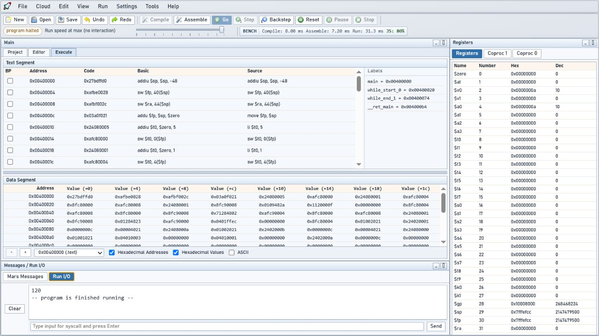

# webMARS v0.6.3

Live test: [https://webmars.nfiles.top/](https://webmars.nfiles.top/)

Public learning pages: [English](https://webmars.nfiles.top/discover/) ·
[Português](https://webmars.nfiles.top/discover/pt/). They cover getting started,
teaching, stack/recursion, pipeline and Mini-C without requiring JavaScript.
Regenerate them with `npm run docs:public` after updating the product version.
See [automatic usage statistics](docs/usage-metrics.md) for the product-use measurement
schema and the separate Raspberry Pi collector installation.



`webMARS` is a browser implementation of MARS MIPS 4.5: editor, assembler, simulator, help system, and classic MARS tools in a single web UI.

## Overview

- Single-page IDE for editing, assembling, running, stepping, backstepping, and debugging MIPS programs.
- Multi-window desktop/mobile UI with registers, text/data segments, labels, messages, Run I/O, and tool windows.
- Built-in help system with localized pages and embedded reference material.
- Persistent browser workspace for files, session restore, settings, and tool state.
- Single JavaScript assembler and simulator core, with no native runtime dependency.

## Current Status

- Feature-complete product line; normal development is now limited to bug fixes, compatibility work and documentation.
- Main target is practical compatibility with Java MARS 4.5 behavior inside the browser.
- Some edge cases can still differ from desktop Java MARS.
- The runtime deliberately uses one JavaScript implementation to keep behavior, debugging, and maintenance predictable.
- This release is a static web application, not an installable/offline PWA; serve it over HTTP using the included local server or a static host. The public statistics panel requires the optional same-origin Raspberry Pi metrics endpoint.

## Manual do webMARS

[`manual/`](manual/README.md) is the independent, Portuguese-language webMARS
manual. It has its own semantic version (`0.1.1`), changelog, static build and
test suite. This edition was authored for webMARS `0.6.2`, remains bundled with
`0.6.3`, and includes
searchable reference data plus real light-theme screenshots for every tool.

```bash
cd manual
npm run validate
npm run serve
```

## Highlights in v0.6.3

- Added an integrated Help > Usage statistics window with public aggregate charts for the last 60 minutes, 24 hours and 30 days, including filters and exact-value tables.
- Added a public, aggregate-only Raspberry Pi statistics endpoint. It separates interaction time from visible presence and exposes no session identifiers.
- Replaced the Public Library selection dialog with a searchable, paginated details view of published projects.
- Expanded automatic usage events and linked heartbeat samples to the same temporary session as other events.

## Main Capabilities

- Multi-file editor with syntax highlighting, undo/redo, tabs, and read-only handling where appropriate.
- Assemble, Go, Step, Backstep, Pause, Stop, and Reset flows.
- Breakpoints, run-speed control, popup/input syscalls, and runtime state restore.
- Registers, COP0, COP1, text segment, data segment, symbol/label table, and Mars Messages/Run I/O panes.
- MARS-style tools such as Bitmap Display, Cache Simulator, Digital Lab Sim, Keyboard/Display MMIO, and more.
- System, light and dark interface themes, selected in `Settings > Interface...` and applied to the editor,
  tool windows and help pages. System follows the browser color scheme and is the default.
- Localized UI, examples, documentation and help for English, Spanish, Portuguese, Mandarin Chinese, Hindi, Arabic, French, Bengali, Russian, Indonesian, German, Japanese, Korean, Turkish, Vietnamese, Urdu, Italian, Polish, Persian and Thai.
- Right-to-left layout is applied automatically for Arabic, Urdu and Persian.
- On a fresh session, the interface follows the first supported language reported by `navigator.languages` (for example, `pt-PT` selects Portuguese); unsupported languages fall back to English, and an explicit saved choice always takes priority.
- Browser storage for source files with virtual folders and quota management.
- Project/editor/runtime workflow with persistent preferences and recoverable session state.
- Optional per-installation BackMars accounts, Cloud projects, public examples/exercises and email-based account recovery.

## Run Locally

Requirements:

- Node.js 20 or newer.

Install the exact development metadata from `package-lock.json` (the project
has no runtime npm dependencies):

```bash
npm ci
```

Start the local server from the repository root:

```bash
npm start
```

Default URL: `http://127.0.0.1:8080`. Use `npm start -- --port 9000` to select another port.

The Windows-only server remains available as an alternative:

```powershell
.\start-web.bat
```

## Build, Test, and Validate

The browser application is shipped as static source. Its normal build checks the complete script graph, JavaScript/JSON syntax, required assets, and privacy declarations:

```bash
npm run build
```

Run the JavaScript runtime regression tests:

```bash
npm test
```

Run the complete pre-change/pre-commit validation:

```bash
npm run validate
```

Create the isolated, reproducible release directory, ZIP, and SHA-256
checksum under `dist/`:

```bash
npm run package:release
```

The package is assembled from an explicit public-file allowlist and validates
its copied files, manifests, local references, JavaScript/JSON syntax, ZIP
contents, CRCs, and checksums before it is published.

## Runtime Benchmarks

The toolbar includes a compact, local-only benchmark strip for Mini-C compilation, assembly, execution time, and estimated JavaScript utilization. The JS percentage is instrumented main-thread busy time divided by elapsed time; it is not the operating system's total CPU percentage.

Detailed volatile metrics include sample counts, averages, minimum/maximum durations, recent history, outcomes, and execution throughput. They can be inspected while developing with:

```js
window.WebMarsBenchmarks.snapshot()
window.WebMarsRuntimeDebug.getBenchmarks()
```

Measurements are kept only in memory and are neither persisted nor transmitted.

## Repository Layout

- `index.html`: shell page and startup loader.
- `assets/js/app.bundle.js`: ordered module bootstrap.
- `assets/js/app-modules/00-core.js`: assembler and simulator core in JavaScript.
- `assets/css/styles.css`: theme tokens for the light and dark themes plus the base component styles.
- `assets/js/app-modules/10-ui.js`: windowing/layout/UI foundation.
- `assets/js/app-modules/19-runtime-benchmarks.js`: local timing, JS-utilization, and throughput collector.
- `assets/js/app-modules/19-public-library.js`: deployment identity, stable route parsing and public BackMars requests.
- `assets/js/app-modules/20-app-runtime.js`: runtime orchestration, commands, persistence, and integration glue.
- `tools/`: pluggable MARS-style tool windows.
- `help/`: built-in help, about/info pages, changelog, and reference content.
- `manual/`: independently versioned user manual, static site and screenshot set.
- `tests/`: JavaScript runtime regression tests, differential corpus and evidence checks.
- `docs/`: generated evidence reports, developer guides and the teaching materials.
- `scripts/`: local server, validation, release packaging and every report generator.

## Evidence and Measurement

Every public claim webMARS makes about itself is backed by a reproducible report.
[`docs/evidence.md`](docs/evidence.md) is the index: each report has one
regeneration command, the suite checks its structure and version, and it
regenerates the compatibility matrix byte for byte. The release gate reruns the
measurement commands below before the version is tagged.

```bash
npm run docs:matrix                            # capability inventory with per-row evidence
npm run fetch:mars && npm run differential      # conformance against the real MARS 4.5
npm run coverage                                # coverage with per-module floors
npm run mutation                                # would the tests notice if the code were wrong?
npm run benchmark                               # performance under a published protocol
npm run audit:a11y                              # WCAG 2.2 audit and accessibility statement
```

| Report | Answers |
| --- | --- |
| [comparison-matrix.md](docs/comparison-matrix.md) | What is supported, and what proves it? |
| [mars-conformance.md](docs/mars-conformance.md) | Where does it differ from MARS 4.5, and why? |
| [coverage-report.md](docs/coverage-report.md) | How much of the shipped source do the tests run? |
| [mutation-report.md](docs/mutation-report.md) | Would the tests catch a defect? |
| [benchmark.md](docs/benchmark.md) | How fast, under what protocol, on what machine? |
| [accessibility.md](docs/accessibility.md) | Which WCAG criteria were checked, and which were not? |
| [portability.md](docs/portability.md) | Which browsers and platforms were actually run? |

The conformance suite downloads a checksum-pinned MARS 4.5 build and refuses any
other, then assembles and runs the same programs in both simulators, comparing
machine code, data segment, console output and all 32 registers. Differences are
defects unless declared with a reason and a minimal reproduction case.

Note that the functional runtime is **not** cycle-accurate and reports no cycle
counts. Timing belongs exclusively to the Pipeline Lab, a separate model that
declares its profile, version and branch-outcome assumption in every export.

## Teaching Materials

[`docs/labs/`](docs/labs/) holds seven guided laboratories on the five-stage
pipeline, with objectives, prerequisites, a predict-before-you-run step and
reflection questions, plus separate solution sheets and a teacher adoption
guide. Every number a worksheet quotes is re-measured against the model by the
test suite, so a sheet cannot disagree with the tool a student is using.

## Contributing

- [`docs/contributing-first-change.md`](docs/contributing-first-change.md) - clone to merged change.
- [`docs/code-architecture.md`](docs/code-architecture.md) - module map, boundaries and dependency direction.
- [`docs/adding-instructions.md`](docs/adding-instructions.md) - instructions and pseudo-instructions.
- [`docs/adding-syscalls-and-devices.md`](docs/adding-syscalls-and-devices.md) - syscalls and MMIO devices.
- [`docs/runtime-invariants.md`](docs/runtime-invariants.md) - what memory, snapshots and backstep guarantee.
- [`docs/tool-api.md`](docs/tool-api.md) - writing a tool for the Tools menu.
- [`docs/localization.md`](docs/localization.md) - adding interface strings without degrading 17 catalogs.
- [`docs/release-process.md`](docs/release-process.md) - how a version is cut and what it promises.

## Citing

See [`CITATION.cff`](CITATION.cff) and
[`docs/technical-summary.md`](docs/technical-summary.md), a citable description
of the system with every figure linked to the report that produced it.

## Help and Documentation

- The built-in help inside the application is the authoritative user-facing reference.
- Public repository documentation is intentionally kept lightweight and should not override runtime behavior.

## Release Line

- `v0.6.3`: public usage-statistics charts and aggregate endpoint, searchable paginated Public Library, expanded session-linked metrics
- `v0.6.2`: public English and Portuguese discovery pages, duration-only active-time heartbeat, aggregate Raspberry Pi collector, privacy documentation and expanded release validation
- `v0.6.1`: complete deployment package with Manual and Teacher Kit, authoritative stable-ID tombstones, exact Public Library pagination, accessibility corrections and stricter release validation
- `v0.6.0`: permanent example links, versioned public project publishing, account recovery and verification, deployment-owned configuration, first-run welcome, Teacher Kit, and the independent Manual v0.1
- `v0.5.6`: Pipeline Lab replaying the real execution with register values, linked step transports, vertical pipeline and responsive rework, generated conformance/coverage/mutation/benchmark/accessibility evidence, and 872 newly translated interface strings
- `v0.5.5`: Pipeline Lab, twenty-language interface/help/examples, scalable cycle history, and expanded UI/tool regression coverage
- `v0.5.4`: MARS-OS desktop/window overhaul, improved TTY, automatic virtual-display fitting, collapsed display settings, and browser-aware system theme
- `v0.5.3`: browser-language bootstrap fix for fresh sessions and private windows
- `v0.5.2`: ten-language UI/help/examples, automatic browser-language selection, Arabic RTL, mouse-driven MARS-OS desktop, and faster responsive TTY
- `v0.5.1`: external device interrupts, System Clock and Stack Visualizer tools, consolidated file/cloud workflows, faster tool batching, resilient text snapshots, and MARS-OS clock/benchmark commands
- `v0.5.0`: hardened JavaScript runtime, inverse-delta backstep, batched tools, dynamic Bitmap MMIO, expanded examples/documentation, and complete mobile workflows
- `v0.4.13`: mobile single-panel layout with icon tabs, icon-only mobile toolbar, and fully localized assembler and Mini-C diagnostics
- `v0.4.12`: dark theme, immediate font-size apply, dead-code cleanup (autosave pipeline, ~15 functions, dead CSS, 113 i18n keys), closeAllFiles wired to menu
- `v0.4.11`: persistent cloud login restoration across refreshes and browser restarts, with updated privacy documentation and regression coverage
- `v0.4.10`: batched tool deltas, lighter runtime UI synchronization, Firefox separator correction, lower idle MMIO polling, and complete 100-step tool parity
- `v0.4.9`: dependable sparse backsteps, synchronous browser tools, Java-compatible random syscalls, stronger state import and expanded runtime/example validation
- `v0.4.8`: delta-based backsteps, synchronous MMIO devices, faster tool delivery, corrected C bitmaps, expanded regression coverage, and optional Bench UI
- `v0.4.7`: JavaScript runtime consolidation, benchmarks, execution correctness, stronger snapshots, expanded examples, complete multilingual help, and release validation
- `v0.4.6`: startup hardening, help/PDF fixes, browser-storage timestamp fix, runtime cleanup, dead-code removal, legacy script/result purge
- `v0.4.5`: cloud backend/login productionization + project/editor workflow improvements + storage/sync refinement
- `v0.4.4`: Mini-C profile and library expansion, runtime coverage, tools, examples, and project workflow improvements
- `v0.4.3`: Mini-C/C0 compiler integration + UI renewal and project-first workflow
- `v0.4.2`: UI polish + simulation runtime bug fixes + final MARS 4.5 parity adjustments
- `v0.4.1`: register window fixes + tighter MIPS-like register/memory access behavior
- `v0.4.0`: mobile adaptation + i18n + large stabilization cycle
- `v0.3.9`: UI fixes + WASM (C++) core reimplementation
- `v0.3.8`: core fixes and UI improvements
- `v0.3.7`: initial git baseline
