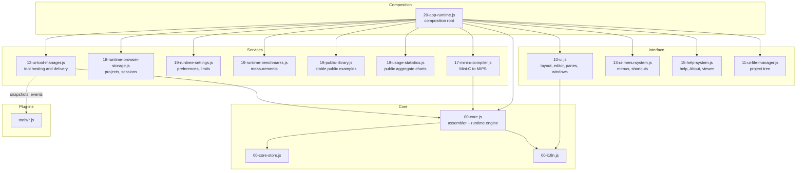

# webMARS Code Architecture (v0.6.4)

webMARS is a static browser application built from ordered, non-ES-module
scripts. The assembler and simulator use one JavaScript implementation; the
experimental WASM/hybrid backend is no longer part of the application.

## Entry and bootstrap

- `index.html`
  - Loads `assets/css/styles.css` and `assets/js/app-version.js`.
  - Resolves the stored `theme` preference inline before first paint so the
    splash and the interface never flash the light theme on a dark-theme load.
  - Starts `assets/js/app.bundle.js` with the current application version in the
    URL so browser caches follow the release version.

- `assets/js/app.bundle.js`
  - Loads the script graph sequentially because modules share browser globals
    and must be initialized in a fixed order.
  - Loads the i18n core and generated MARS reference data first.
  - Reads `assets/js/i18n/languages.json` and falls back to English if the
    language manifest cannot be loaded.
  - Loads the application modules last, ending with
    `assets/js/app-modules/20-app-runtime.js`.

The app should be served over HTTP. Manifests, examples, help documents, tools
and libraries are loaded as local resources at runtime.

## Layer map

Dependencies point downwards only. The core never reaches upwards into the
interface: it has no DOM access at all, which is what lets the whole engine run
under Node in the test suite.

## Boundaries

Each boundary below is a rule about what may cross it, not just a picture of
what currently does.

### Assembler and runtime engine (`00-core.js`)

- **Owns**: parsing, macro and pseudo expansion, encoding, the memory map,
  registers, COP0/COP1, exceptions, syscalls, breakpoints, backstep, and
  runtime-state import and export.
- **Must not**: touch the DOM, read `localStorage`, or know that a browser
  exists. Anything needing the user goes through `runtimeHooks`, which the app
  runtime installs.
- **Exposed as**: `createMarsEngine`.
- **Invariants**: [runtime-invariants.md](runtime-invariants.md).

### Mini-C compiler (`17-mini-c-compiler.js`)

- **Owns**: detection, parsing, semantic checks and MIPS generation for
  Mini-C/C0 and C1-NATIVE.
- **Must not**: depend on UI state or on the engine's *runtime* state. It emits
  assembly text; the engine assembles it like any other source.

### Interface (`10-ui.js`, `11-*`, `13-*`, `15-*`)

- **Owns**: layout, windows, editor, panes, dialogs, menus and help rendering.
- **Must not**: implement ISA or assembler semantics. A rule about what an
  instruction means belongs in the core even when it is only ever displayed.
- **Must**: resolve every colour through the theme tokens, and route every
  visible string through the translation catalog.

### Storage (`18-runtime-browser-storage.js`)

- **Owns**: browser-backed projects, sessions, files and preferences.
- **Must**: treat a storage failure as an error path. Nothing may report a
  successful save until storage has accepted the write, and a failed
  transactional write must roll back.

### Tools (`12-ui-tool-manager.js` and `tools/*.js`)

- **Owns**: tool discovery, window hosting, and ordered delivery of snapshots
  and runtime events.
- **Guarantees**: a throwing tool is isolated and reported; it never interrupts
  the runtime or the other tools.
- **Contract**: [tool-api.md](tool-api.md), versioned as `apiVersion` in
  `tools/tools.json`.

### Composition root (`20-app-runtime.js`)

- **Owns**: wiring everything above together - preferences, projects, sessions,
  commands, the run loop, persistence, cloud adapters, tools, help, and UI
  synchronisation.
- **Must stay last** in the load order. Nothing may depend on it.

### Pipeline Lab (`tools/pipeline-lab.js`)

A tool, not part of the runtime. It reads assembled instructions and models
timing; it never executes the program and never touches machine state. This
separation is the reason the functional runtime can be described honestly as
not cycle-accurate. See [pipeline-lab.md](pipeline-lab.md).

## Ordered script graph

The current bootstrap order is:

1. `assets/js/app-modules/00-i18n.js`
2. `assets/js/reference/pseudo-ops.generated.js`
3. `assets/js/reference/instructions.generated.js`
4. `assets/js/reference/syscalls.generated.js`
5. language packs listed by `assets/js/i18n/languages.json`
6. `assets/js/app-modules/00-core-store.js`
7. `assets/js/app-modules/00-core.js`
8. `assets/js/app-modules/05-layout-config.js`
9. `assets/js/app-modules/09-ui-translation.js`
10. `assets/js/app-modules/10-ui.js`
11. `assets/js/app-modules/11-ui-file-manager.js`
12. `assets/js/app-modules/12-ui-tool-manager.js`
13. `assets/js/app-modules/13-ui-menu-system.js`
14. `assets/js/app-modules/15-help-system.js`
15. `assets/js/app-modules/17-mini-c-compiler.js`
16. `assets/js/app-modules/18-runtime-browser-storage.js`
17. `assets/js/app-modules/19-runtime-settings.js`
18. `assets/js/app-modules/19-runtime-benchmarks.js`
19. `assets/js/app-modules/19-public-library.js`
20. `assets/js/app-modules/19-usage-statistics.js`
21. `assets/js/app-modules/20-app-runtime.js`

## Current modules

| Module | Current responsibility |
| --- | --- |
| `00-i18n.js` | Language registration, selection, translation and language-change events through `WebMarsI18n`. |
| `00-core-store.js` | Small observable state-store factory exposed through `WebMarsModules.coreStore`. |
| `00-core.js` | JavaScript MIPS assembler and execution engine: parsing, encoding, memory, registers, COP0/COP1, exceptions, syscalls, breakpoints, backstep and runtime-state import/export. |
| `05-layout-config.js` | Shared compact and stacked layout breakpoints through `WebMarsLayoutConfig`. |
| `09-ui-translation.js` | Static DOM-tree translation helper used by the main UI and auxiliary windows. |
| `10-ui.js` | File-kind classification, application layout, editor and execution panes, window management, dialogs and UI rendering helpers. |
| `11-ui-file-manager.js` | Shared file-manager chrome, project-tree rendering, folder/file operations, drag-and-drop imports and the collection browser used by Cloud projects and publications. |
| `12-ui-tool-manager.js` | Tool manifest loading, script registration, tool-window hosting and ordered delivery of runtime snapshots. |
| `13-ui-menu-system.js` | Menu definitions, popup/submenu behavior, checks, shortcuts and command dispatch. |
| `15-help-system.js` | Localized in-app help, About window and internal document viewer. |
| `17-mini-c-compiler.js` | Mini-C/C0 and C1-NATIVE source detection, parsing, semantic checks and MIPS generation. |
| `18-runtime-browser-storage.js` | Browser source-folder storage and the related file, preference, memory-map and example-loading workflows consumed by the app runtime. |
| `19-runtime-settings.js` | Runtime preference validation, memory/backstep limits, address parsing, language-preference and theme-preference helpers. |
| `19-runtime-benchmarks.js` | In-memory compile, assemble and run measurements, including duration, estimated instrumented JavaScript utilization and throughput. |
| `19-public-library.js` | Stable built-in-example and public-publication routes, public-library browsing, publication and immutable revision links. |
| `19-usage-statistics.js` | Help-menu statistics window with aggregate charts, filters, exact-value tables and localized labels. |
| `20-app-runtime.js` | Final composition root: preferences, projects and sessions, compiler/assembler commands, run loop, persistence, cloud adapters, tools, help and UI synchronization. |

The files under `assets/js/reference/` are generated data consumed by the core
and help system, not alternative execution engines.

## Dependency contracts

- Extracted services are normally published under `window.WebMarsModules`.
- Established browser-facing APIs such as `WebMarsI18n`,
  `WebMarsLayoutConfig`, `createMarsEngine` and
  `createMarsJavaStyleHelpSystem` remain globals because the loader is not ESM.
- `20-app-runtime.js` is the composition root and therefore must stay last.
- A module must not silently depend on a script loaded after it.
- Changes to a shared global or registry entry require tests for every consumer.

## Current concentration and maintenance boundaries

Most behavior is still concentrated in four large files:
`00-core.js`, `10-ui.js`, `17-mini-c-compiler.js` and `20-app-runtime.js`.
This is technical debt, but it is also a compatibility boundary. Refactoring
should remain incremental:

- extract pure validation, formatting or conversion helpers before moving
  stateful orchestration;
- keep assembler/simulator semantics in the core and browser workflow in the
  app runtime;
- keep Mini-C parsing and code generation independent from UI state;
- send complete runtime snapshots to tools that require them;
- preserve public globals until all consumers have migrated together;
- add regression coverage before changing an execution or persistence
  boundary.

Names such as `core/syscalls` or `runtime/session` may be useful conceptual
boundaries for future extraction, but they are not directories or modules in
the v0.6.4 tree.

## Theming

`assets/css/styles.css` declares every interface color as a custom property in
two blocks: `:root` for the light theme, which is the original webMARS
appearance and the default, and `:root[data-theme="dark"]` for the dark theme.
Modules, tool windows and help pages must resolve colors through those tokens
instead of literals; `release-readiness.test.mjs` enforces this for the injected
stylesheets and checks that both blocks declare the same token set.

The `theme` preference drives `applyThemePreference` in `19-runtime-settings.js`,
which sets `data-theme` on the document element and emits
`webmars:theme-changed`. Help documents render in frames and cannot inherit the
tokens, so `15-help-system.js` follows that event: pages that link
`help/en/webmars-help.css` receive the `data-theme` attribute, and older pages
receive a small generated stylesheet built from the current token values.

Colors that represent simulated device output - bitmap and terminal screens,
LEDs, seven-segment displays and the ANSI palette - deliberately stay literal so
a device keeps looking like the hardware it emulates.

## Supporting directories

- `assets/js/i18n/`: UI language packs and their manifest.
- `tools/`: pluggable MARS-style tools registered through `MarsWebTools`;
  discovery is driven by `tools/tools.json`.
- `help/`: localized in-app documentation and MARS reference material.
- `examples/`: localized Assembly and C examples plus `examples/examples.json`.
- `libs/`: Mini-C/C0 libraries, compatibility headers and `libs/manifest.json`.
- `tests/`: assembler, runtime, tools, examples, help and release regression
  coverage.
- `scripts/`: local server, static validation and reproducible release
  packaging.

## Contributor checks

- Keep the ordered loader and module registry coherent.
- Do not reintroduce the removed WASM/hybrid backend.
- Treat browser storage failure as a normal error path, not as successful
  persistence.
- Keep benchmark data local and volatile.
- Run `npm run validate` before release work; use `npm run package:release` to
  build the allowlisted release artifact.

## Developer documentation

| Document | Answers |
| --- | --- |
| [contributing-first-change.md](contributing-first-change.md) | How do I clone, run, test and land a first change? |
| [adding-instructions.md](adding-instructions.md) | How do I add an instruction or pseudo-instruction? |
| [adding-syscalls-and-devices.md](adding-syscalls-and-devices.md) | How do I add a syscall or a memory-mapped device? |
| [runtime-invariants.md](runtime-invariants.md) | What may I assume about memory, snapshots and backstep? |
| [tool-api.md](tool-api.md) | How do I write a tool for the Tools menu? |
| [release-process.md](release-process.md) | How is a version cut, and what does it promise? |
| [pipeline-lab.md](pipeline-lab.md) | What does the cycle-accurate model do and not do? |
| [comparison-matrix.md](comparison-matrix.md) | What is supported, and what is the evidence? |
| [mars-conformance.md](mars-conformance.md) | Where does webMARS behave differently from MARS 4.5, and why? |
| [evidence.md](evidence.md) | Where is the evidence for every public claim? |
| [technical-summary.md](technical-summary.md) | How do I describe and cite this system in a paper? |
| [benchmark.md](benchmark.md) | How fast is it, under what protocol, on what machine? |
| [accessibility.md](accessibility.md) | Which WCAG criteria were checked, and which were not? |
| [portability.md](portability.md) | Which browsers and platforms has it actually been run on? |
| [coverage-report.md](coverage-report.md) | How much of the shipped source do the tests execute? |
| [mutation-report.md](mutation-report.md) | Would the tests notice if the code were wrong? |
