# webMARS - Atlas do projeto em Mermaid

Propósito, filosofia, arquitetura e algoritmos, explicados através de diagramas
editáveis. Leitura do webMARS **0.6.6**, revista em **29 de outubro de 2026**,
com base no commit `098494f17a36b14a6639048e834550ebd07f7a58`.

Este ficheiro é a fonte principal do atlas. Os blocos `mermaid` são apresentados
como diagramas em leitores compatíveis, incluindo o GitHub. Podem ser editados
diretamente em Markdown, sem gerar um PDF nem alterar a aplicação.

## 1. Propósito: tornar a máquina compreensível

O programa é o fio condutor: o utilizador escreve, observa o comportamento,
experimenta configurações e partilha o trabalho. As ferramentas acrescentam
perspetivas sobre esse mesmo programa.

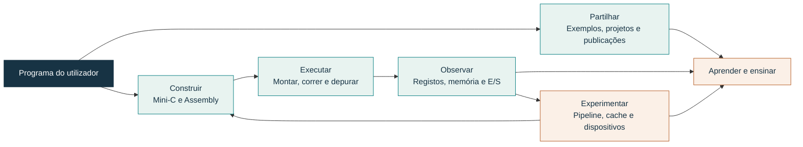

**Fronteira de escopo:** Mini-C é um subconjunto de C; o sistema de ficheiros é
virtual; a execução é uma simulação educativa. Conta e serviços Online não são
requisitos para editar, compilar, montar ou executar localmente.

## 2. Filosofia: princípios traduzidos em decisões

Este mapa é uma interpretação dos contratos atuais do projeto. Explica por que
uma fronteira técnica importa para a experiência de quem usa a aplicação.

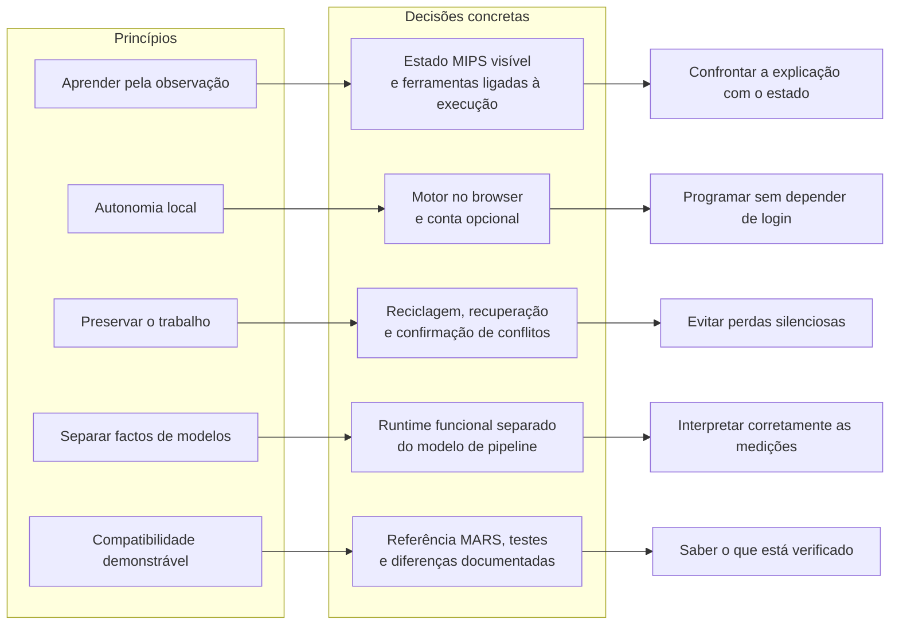

Coerência visual, teclado, temas e traduções atravessam estes princípios: uma
funcionalidade deve continuar compreensível quando muda a janela, o idioma ou
a localização do projeto.

## 3. Mapa de camadas: quem coordena quem

As caixas agrupam responsabilidades dos ficheiros atuais. As setas indicam
coordenação ou resultados; não representam a ordem de carregamento dos scripts.

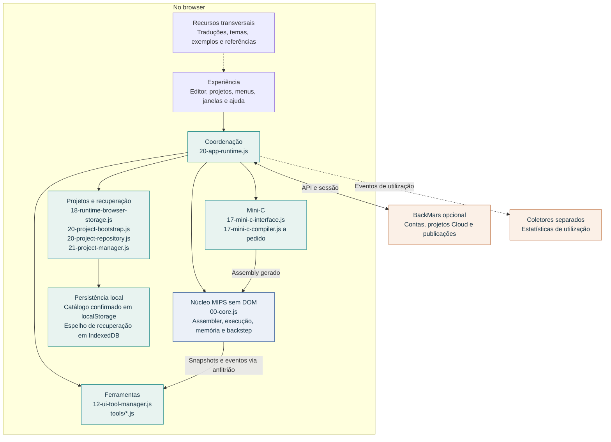

O núcleo não acede ao DOM nem ao armazenamento do browser. A coordenação instala
as ligações necessárias entre motor, interface e serviços. O projeto usa scripts
ordenados com globais partilhados; as camadas acima não implicam uma arquitetura
ESM ou diretórios que não existem.

## 4. Do código à execução: três operações diferentes

Compilar produz Assembly. Montar produz instruções e dados. Executar transforma
o estado MIPS. O Assembly gerado por Mini-C percorre a mesma montagem que o
Assembly escrito à mão.

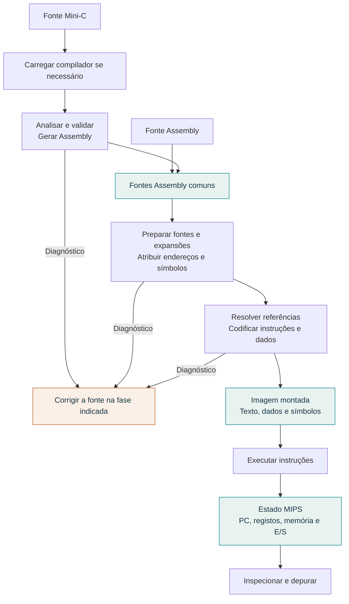

O mapa simplifica o algoritmo do assembler; não enumera todos os mecanismos de
macros, diretivas e resolução. Uma falha numa fase não deve ser confundida com
um erro da fase seguinte.

## 5. Execução e backstep: alterações com um rasto inverso

O percurso normal de uma instrução é mostrado abaixo. Os desvios de exceção,
os pedidos de input e os detalhes das syscalls têm contratos próprios.

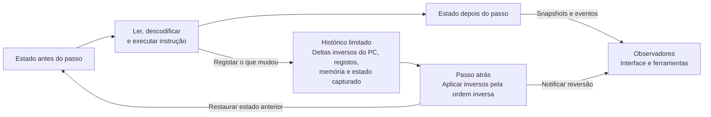

Invariantes: `$zero` permanece zero; acessos à memória passam pela API; snapshots
não podem ser alterados pelos consumidores. O histórico tem limites de passos
e bytes: não se promete recuar além do que foi conservado.

## 6. Pipeline: dois relógios e dois fluxos

Um passo funcional executa uma instrução. Um ciclo de pipeline pertence a uma
microarquitetura modelada, com opções de forwarding, predição e latência.

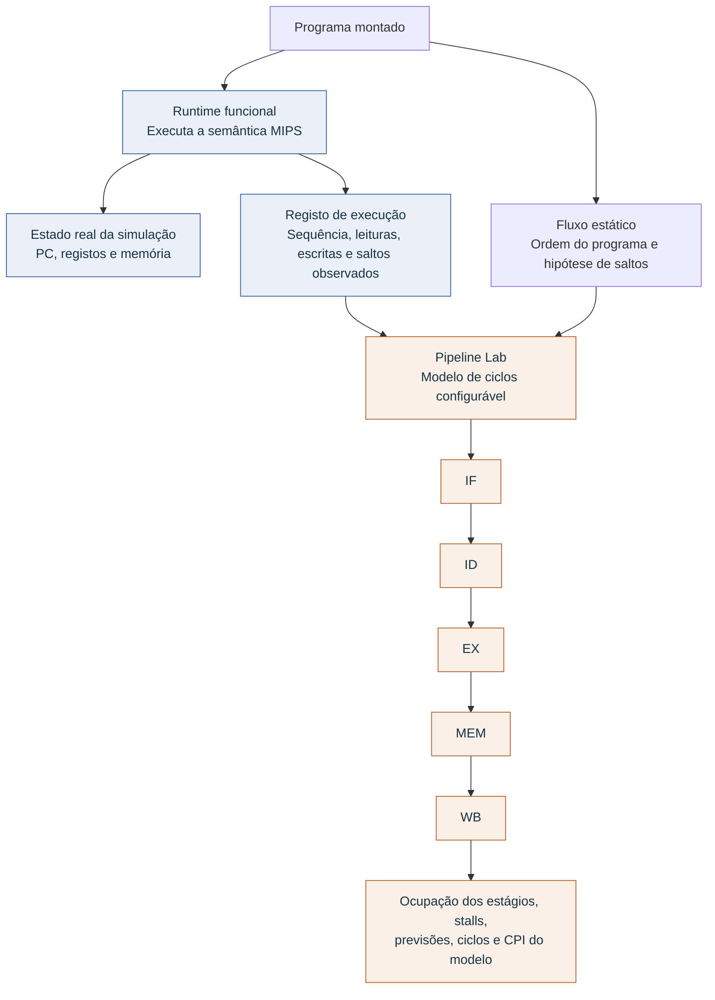

O Pipeline Lab não escreve no estado do runtime. No fluxo estático, os resultados
dos saltos são hipóteses declaradas e não há valores de execução. No replay,
utiliza-se a sequência realmente registada. Ciclos modelados não medem a
velocidade real do browser.

## 7. Projetos: identidade, cópias e publicação

Uma localização não é um formato diferente de projeto. Uma publicação representa
uma revisão partilhável; consultar essa revisão não dá acesso de edição à pasta
do autor.

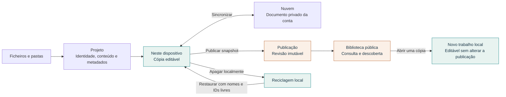

Apagar localmente não elimina a cópia Cloud. As ações disponíveis dependem da
localização, das permissões e da seleção. Publicações são snapshots imutáveis;
as ações de gestão do autor tratam revisões, visibilidade e arquivo.

## 8. Recuperação: um catálogo vazio também é uma decisão

Estes estados descrevem a política de arranque, não um novo enum persistido.
O objetivo é impedir que um snapshot antigo faça reaparecer um projeto apagado.

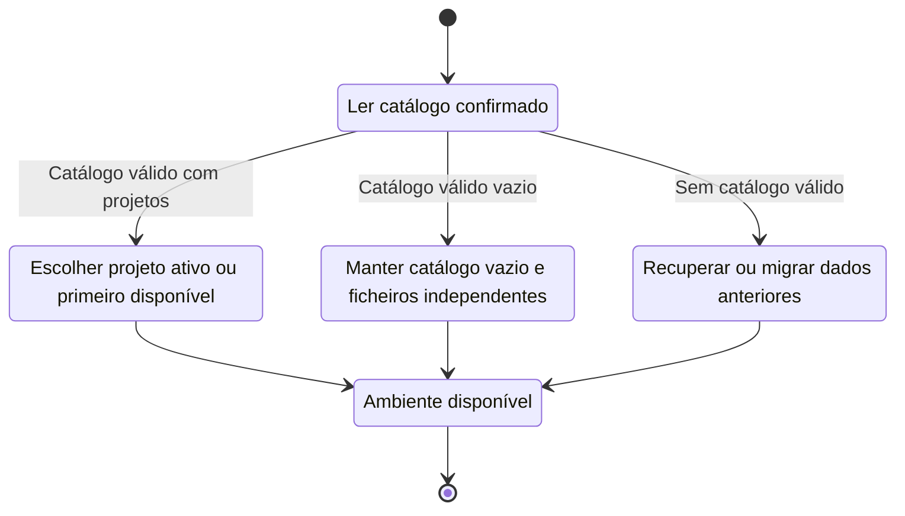

Na implementação atual, o catálogo confirmado em **localStorage** é a fonte de
verdade. O espelho **IndexedDB** é atualizado após gravações confirmadas e serve
a recuperação. A migração integral para IndexedDB principal continua em aberto.

## 9. Conflitos: escolher antes de substituir

Fluxo da gravação conservadora de um projeto na Cloud. A sincronização da coleção
também compara projetos, mas este diagrama foca a decisão de substituição.

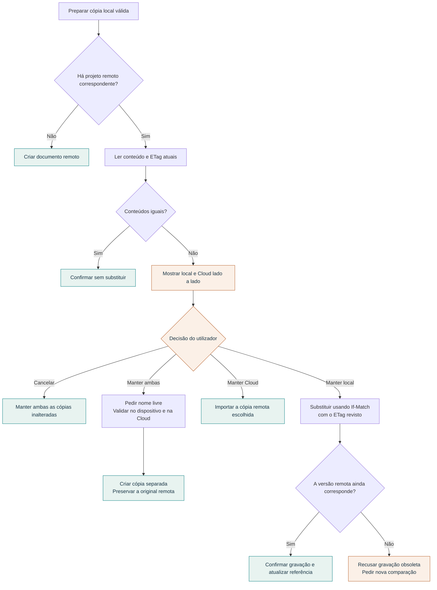

O algoritmo escolhe cópias completas; não promete uma fusão automática de linhas.
Falhas de rede, importação ou persistência continuam a ser resultados de erro,
não confirmações de sucesso.

### Porque é que o ETag continua necessário após a confirmação?

O utilizador pode comparar duas cópias e, antes de confirmar, outro dispositivo
alterar a cópia remota. A decisão humana e a precondição do servidor protegem
momentos diferentes.

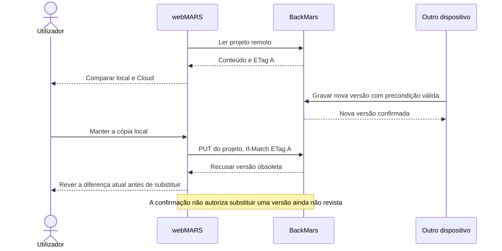

## 10. Dados e rede: fronteiras explícitas

Executar o programa no browser não implica ausência de rede. A instalação pode
consultar a sessão, carregar recursos e enviar estatísticas configuradas.

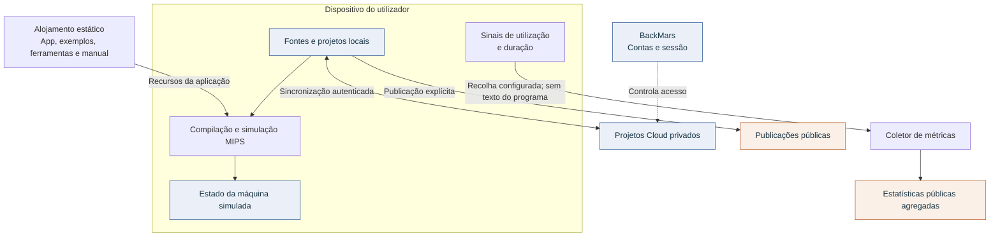

A instalação oficial tem recolha automática configurada. Sessões medidas não
são pessoas únicas; as classes de tráfego são sinais estatísticos, não prova
de humanidade. Os agregados de atividade Cloud confirmados pelo servidor são
distintos da recolha de utilização no browser.

## 11. Evidência: da alteração ao artefacto publicado

O projeto liga o comportamento a testes e a uma versão identificável. Este mapa
organiza as verificações; não afirma que todos os tipos de teste são executados
em todos os jobs de CI.

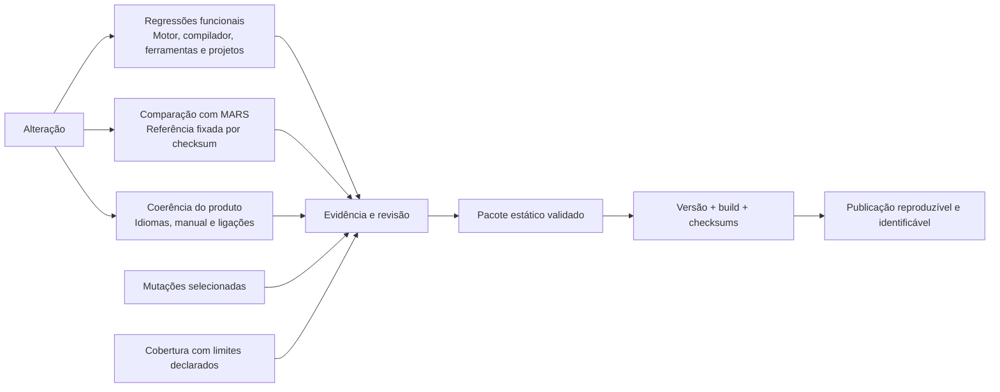

No relatório desta versão, 11 programas de referência produzem 8 resultados
idênticos ao MARS e 3 com diferenças declaradas, sem diferenças inexplicadas.
As 12 mutações selecionadas foram detetadas. Estes conjuntos são limitados:
cobertura não prova correção e nenhum destes números equivale a compatibilidade
integral ou a uma auditoria completa da interface.

## 12. Evolução: preservar contratos enquanto se simplifica

O trabalho em aberto deve ser lido como direção de manutenção, sem datas
implícitas ou funcionalidades prometidas.

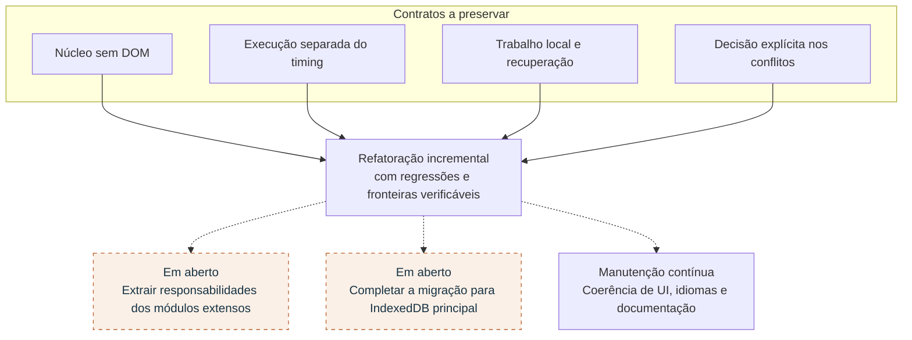

## Fontes e manutenção

As fontes principais são a [arquitetura](code-architecture.md), os
[invariantes](runtime-invariants.md), o [Pipeline Lab](pipeline-lab.md), as
[métricas](usage-metrics.md), a [evidência](evidence.md), `webmars-config.js` e os
módulos indicados nos mapas. O código e os contratos específicos prevalecem
sobre resumos mais antigos.

Para atualizar: editar o texto e os blocos Mermaid neste ficheiro; rever as
afirmações contra o código; confirmar a renderização dos diagramas. Os mapas
são conceptuais, não uma especificação exaustiva de todas as chamadas ou erros.
Não são consultados dados de utilizadores nem serviços de produção para os gerar.

A [edição anterior em PDF](../output/pdf/webmars-atlas-do-projeto.pdf) é uma
apresentação complementar, com fonte própria em
[`scripts/generate-project-atlas.py`](../scripts/generate-project-atlas.py).
Alterar este Markdown não atualiza automaticamente esse PDF.
