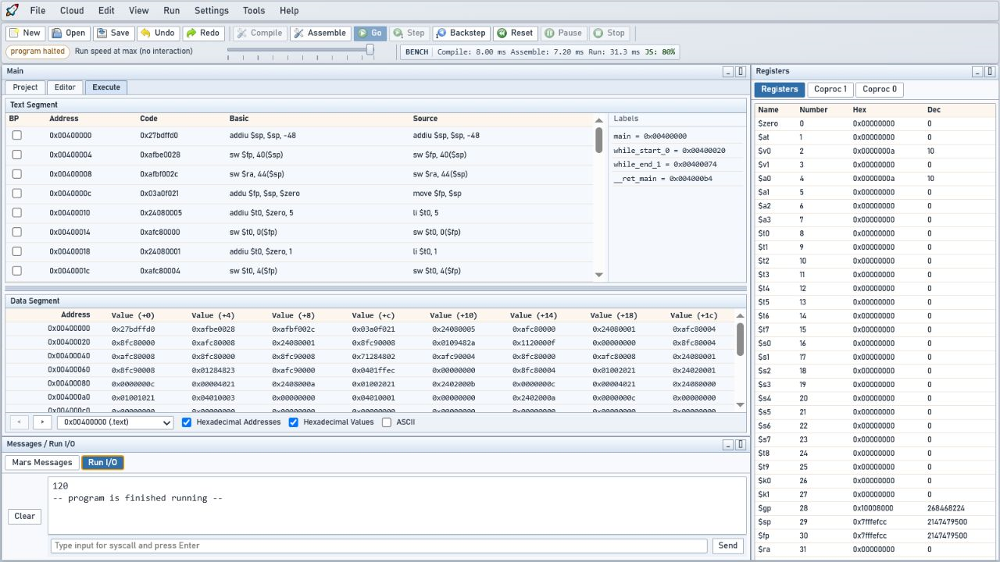

# Manual do webMARS



O Manual do webMARS é um subprojeto editorial autónomo, com versão e ciclo de
lançamento próprios. A versão `0.2.1` documenta o webMARS `0.6.5` em português
e foi concebida para poder ser publicada tanto em `/manual/` juntamente com a
aplicação como num alojamento estático independente.

## Objetivos

- explicar o produto desde a primeira execução até aos recursos avançados;
- cobrir todos os menus, vistas, preferências e ferramentas incluídas;
- oferecer uma referência pesquisável de instruções, pseudoinstruções e
  diretivas;
- distinguir comportamento compatível com MARS 4.5 de extensões webMARS;
- manter procedimentos reproduzíveis e imagens reais no tema claro;
- funcionar sem frameworks, serviços externos, cookies ou telemetria.

A edição contém 21 capítulos numerados, apêndices e páginas editoriais, além de
36 capturas reais: 16 estados gerais da aplicação e uma captura para cada uma
das 20 ferramentas.

Esta edição inclui o painel público de estatísticas, os seus períodos, filtros,
medições e limites de interpretação, além da Biblioteca pública em tabela,
com pesquisa no servidor e páginas de 25 resultados. A informação de privacidade
e os procedimentos do operador/Kit Docente acompanham a recolha automática da
instalação oficial. O Manual mantém pesquisa local e não envia telemetria.

A atualização editorial em preparação acrescenta o manual integrado em
**Ajuda → Abrir o Manual**, com tema sincronizado e abertura do mesmo capítulo
num separador independente. O índice pode ser filtrado por assunto. Os guias
cobrem entrada Google, associação e fusão de contas existentes, os separadores
Panorâmica/Recursos/Cloud das estatísticas e a exportação CSV. As capturas
anteriores conservam a versão de origem na legenda.

O conteúdo prático acrescenta 13 secções: soma de vetores em Assembly e Mini-C,
chamadas aninhadas, recursão, projeto de três ficheiros, depuração de erros de
limite, framebuffer, interpretação de bits, syscalls e comparação controlada
de pipelines. Os seis programas completos e os resultados dos exercícios são
executados contra o simulador pelos testes do repositório webMARS
(`npm run test:manual`, na raiz). O build autónomo do manual continua a usar
apenas os seus próprios ficheiros.

## Estrutura

- `index.html` — entrada do manual e estrutura acessível da aplicação;
- `content/index.mjs` e `content/chapters-*.mjs` — conteúdo editorial e
  metadados dos capítulos;
- `content/practice-guides.mjs` — procedimentos, exercícios e resultados;
- `content/worked-examples.mjs` — fontes exatas apresentadas nos tutoriais e
  utilizadas pelos testes de execução;
- `data/` — catálogos webMARS vendorizados que tornam o build autónomo;
- `product-lock.json` — versão, commit auditado, hashes e contagens dos
  catálogos do produto documentado;
- `assets/` — apresentação, navegação e recursos do manual;
- `scripts/build.mjs` — cria a distribuição autónoma em `dist/`;
- `scripts/serve.mjs` — servidor local da distribuição;
- `tests/manual.test.mjs` — valida cobertura estrutural, ligações e metadados;
- `CHANGELOG.md` — histórico exclusivo do manual;
- `CONTRIBUTING.md` — regras editoriais e de manutenção;
- `SCREENSHOTS.md` — protocolo para capturas de ecrã consistentes;
- `VERSION` — versão editorial corrente, independente da aplicação.

## Utilização

```text
npm run validate
npm run serve
```

O servidor local anuncia o endereço do manual. Dentro do repositório principal,
`/manual/` também abre diretamente a versão fonte; o build inclui cópias dos
dados de referência e das imagens necessárias para que `dist/` seja autónomo.

O build, os testes e a versão publicada não consultam o repositório webMARS.
Ao preparar uma nova edição, o mantenedor atualiza deliberadamente a fotografia
auditável do produto a partir de um checkout ou commit selecionado:

```text
npm run vendor:product -- --product-root <checkout-webmars>
npm run vendor:product -- --product-root <checkout-webmars> --commit <hash-completo> --verified-at AAAA-MM-DD
```

Sem `--commit`, o lock fica marcado como pendente e não afirma uma verificação
que ainda não aconteceu. Com um commit, os ficheiros são lidos diretamente
desse objeto Git e os respetivos hashes ficam registados no lock.

## Versionamento

O manual usa versionamento semântico independente da aplicação:

- **patch** — correções editoriais sem alterar a cobertura;
- **minor** — novos capítulos, fluxos ou cobertura de uma versão webMARS;
- **major** — reorganização incompatível de URLs, formato ou público-alvo.

As releases usam o prefixo de tag `manual-v`, por exemplo
`manual-v0.2.1`, para não colidirem com as tags da aplicação.

A versão compatível da aplicação é sempre mostrada no cabeçalho e registada no
changelog. Uma nova versão do webMARS não muda automaticamente a versão do
manual.
